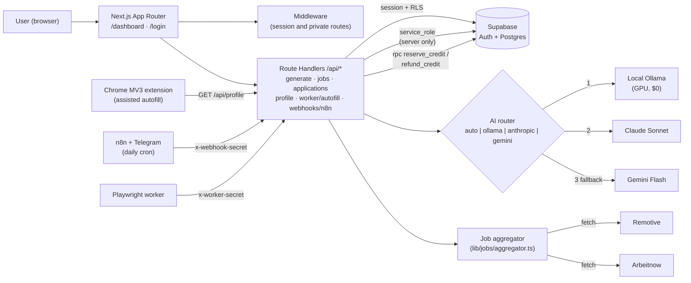

# Job AutoApply — Phases 0, 1, 2, and 3

A job application platform built with Next.js and Supabase for data and authentication.
Designed for job seekers who want to organize opportunities and prepare tailored applications.
Stack: Next.js, Supabase, and hybrid AI with Ollama, Claude, and Gemini.

[](https://github.com/andresaragon/job-autoapply/actions/workflows/ci.yml)

[Leer este documento en español](README.es.md).

## What it includes

- **Next.js 16** (App Router, Turbopack), TypeScript, and Tailwind CSS.
- **Authentication and sessions:** Registration, sign-in, and callback flows with Supabase Auth, plus middleware protecting private routes (`/dashboard`, `/dashboard/jobs`, `/dashboard/applications`, `/dashboard/resumes`, `/dashboard/profile`).
- **Candidate profile (`/dashboard/profile`):** Persistent candidate details (name, phone, LinkedIn, GitHub, portfolio, and location) for form autofill.
- **Resume management:** Upload `.txt` and `.md` files, preview and edit them, and set a primary resume (`es_actual`) with RLS policies.
- **Job aggregator (`/dashboard/jobs`):** Idempotent ingestion from public Remotive and Arbeitnow feeds without API keys; ATS detection for Greenhouse, Lever, Ashby, Workday, and SmartRecruiters; keyword search and filters by work arrangement or ATS; manual job entry; and an action to preload a selected listing into the AI generator.
- **Application tracking (`/dashboard/applications`):** Save tailored applications with generated resumes and letters, track their lifecycle from draft through offer, and inspect or copy generated documents in a modal.
- **ATS-friendly PDF resume export (`components/CvPdfModal.tsx`):** Three typography styles, formatted bullets and semantic sections, and native Letter-size PDF export in a single-column, table-free layout.
- **ATS match score and keyword analyzer (`lib/ats/matcher.ts` and `components/AtsMatchCard.tsx`):** Deterministic lexical and semantic matching between a job listing and tailored resume; an interactive 0–100 score with levels and skill-category breakdowns; matching and missing keyword tabs with one-click copying; and optimization suggestions.
- **ATS autofill assistant (`lib/worker/ats/filler.ts` and `/api/worker/autofill`):** Deterministic field mapping for Greenhouse, Lever, Ashby, and generic forms; a JavaScript injector that triggers DOM `input` and `change` events and highlights completed fields; and a Playwright runner (`worker/autoapply-playwright.mjs`) for automated headless or headed execution.
- **Chrome Manifest V3 extension (`extension/`):** Loadable in Chrome or Edge, detects supported ATS forms, autofills with native React/HTML5 events, highlights filled fields and shows an on-page confirmation. Stores data locally in `chrome.storage.local` and syncs directly from the web app through `/api/profile`. See the [extension installation and usage guide](extension/README.md).
- **n8n webhook and automation bridge (`app/api/webhooks/n8n/route.ts` and `n8n/`):** Webhook-token-protected endpoint supporting `sync_jobs`, `get_pending`, `update_status`, and `telegram_digest`. The exportable `n8n/job_autoapply_pipeline.json` workflow can be imported into n8n and includes scheduled job ingestion, a morning digest, and Telegram alerts. See the [n8n import guide](n8n/README.md).
- **Reactive navbar:** Session status, user email, available credits in real time, and navigation.
- **Hybrid AI architecture:** Local Ollama with `qwen2.5:7b`; Claude (`claude-sonnet-5-5`) as the primary cloud provider; and Google Gemini (`gemini-2.5-flash`) as a fallback.
- `supabase/schema.sql` and migrations in `supabase/migrations/` define `subscriptions`, `profiles`, `resumes`, `job_postings`, `applications`, and `ai_generations`, with RLS, non-negative balance constraints, multi-provider audit support, and performance indexes.
- `app/api/generate/route.ts` provides resilient generation with atomic credit reservation (SQL RPC `reserve_credit`) and an automatic relative refund on any failure (see [Design decisions](#design-decisions)).
- `app/dashboard/page.tsx` provides a dashboard with catalog job preloading, automatic primary resume selection, AI engine selection, loading feedback, and direct saving to *My Applications*.

## Getting started

1. Create a project at [supabase.com](https://supabase.com) and run `supabase/schema.sql` in the SQL Editor. If you already have tables from earlier phases, apply the delta migrations in `supabase/migrations/`.
2. To use local Ollama, make sure it is running and download the model:
   ```bash
   ollama pull qwen2.5:7b
   ```
3. Copy `.env.example` to `.env.local` and fill in the Supabase variables. API keys can be left blank when using only local Ollama.
4. Install dependencies and start the development server:
   ```bash
   npm install
   npm run dev
   ```
5. Open `http://localhost:3000`. To try local generation, add a test row to `resumes` in Supabase with a valid `user_id` and resume text. Enter its `id` and a job listing on `/dashboard`, choose an AI engine, and select **Generate**.

## Architecture



**Pure, deterministic modules** (the most tested): `lib/ats/matcher.ts` (ATS score and keywords),
`lib/worker/ats/filler.ts` (per-ATS field mapping) and `lib/jobs/aggregator.ts` (feed normalization and ATS
detection). All data access goes through Supabase with RLS; the `service_role` client is only used in server
routes.

## Design decisions

### Hybrid AI (local → cloud → fallback)
One prompt and one structured output format (`### CV_ADAPTADO` / `### CARTA_PRESENTACION`), but the provider is
interchangeable. In `auto` mode it tries **Ollama** on the local GPU first (zero cost, and the resume never leaves
the machine), then **Claude** (editorial quality) and finally **Gemini** (free quota as a safety net). Each attempt
fails in isolation and the per-provider errors are returned in `details`. Every generation is audited in
`ai_generations` (provider and tokens). Ollama is not reachable from Vercel, so production should set
`DEFAULT_AI_PROVIDER=anthropic|gemini`.

### Credits: no TOCTOU window
Charging with "read balance → check → write balance" leaves a window where two simultaneous requests see the same
balance and both pass. Instead:

- **Reserve** before calling the AI with a SQL function (`reserve_credit`): a single
  `UPDATE … WHERE creditos_disponibles > 0 RETURNING`, atomic in Postgres.
- **Relative refund** (`refund_credit`, `+1`) if the job does not exist, no provider answers, the model returns an
  invalid format or an exception is thrown; a balance "read earlier" is never restored.
- Defense in depth: `CHECK (creditos_disponibles >= 0)` and functions executable only by `service_role`.
- Covered by concurrency tests (for example 5 simultaneous requests with 3 credits → exactly 3 charges).

### Assisted autofill instead of automatic submission
The app **fills in** Greenhouse, Lever, Ashby or generic forms (deterministic selectors, `input`/`change` events,
visual highlighting) but **does not press "Submit"**: the person reviews and submits. This is deliberate: the terms
of service of many job boards and ATS forbid automated or mass submission, forms include questions and legal
consents that need human judgement, and an application sent with invented or mis-mapped data is hard to withdraw.
Assisted mode keeps the time savings without that risk. The prompt also forbids the AI from inventing experience
that is not in the resume.

## Tests and CI

```bash
npm test          # Vitest, no network or real keys
npm run lint && npm run typecheck
npm run test:extension
```

The tests simulate Supabase (in-memory fake, `tests/helpers/fakeSupabase.ts`), `fetch` (Remotive/Arbeitnow) and
the three AI providers. GitHub Actions (`.github/workflows/ci.yml`) runs `npm ci`, lint, typecheck and the tests
on every push to `main` and every pull request.

## Deployment

The project is ready to deploy on Vercel: connect the repository, add the Supabase and cloud provider (Anthropic / Gemini) environment variables in the project settings, and deploy. A step-by-step guide (Vercel + Supabase, migrations in order, environment variables and the auth callback URL) is in [`docs/DEPLOY.md`](docs/DEPLOY.md), written in Spanish.

## License: MIT
